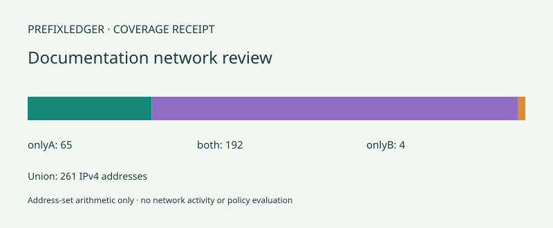

# Prefixledger

Compare two IPv4 lists by **address coverage**, with exact differences, minimal CIDR covers and a receipt linking every covered segment to its original input lines.

**[Open Prefixledger](https://prefixledger.vercel.app)** · [Automated checks](https://github.com/KingReaper6940/prefixledger/actions/workflows/checks.yml)

A `/24` and two adjacent `/25` entries cover the same addresses. Prefixledger recognizes that equivalence instead of comparing the lines as strings.



This image is an actual exported SVG summary, **not an application screenshot**.

## What it does

- Compare **only A**, **both**, **only B**, **union**, and each complete input set.
- Accept IPv4 addresses and CIDRs, with one entry per line and optional `# comments`.
- Explicitly show host-bit normalization, duplicate entries and strictly contained entries.
- Preserve physical input-line IDs, original tokens, comments and source membership.
- Check membership of a single IPv4 address without contacting it.
- Keep 25 analyzed changes in undo history.
- Save resumable project JSON, complete JSON/HTML receipts, a summary SVG, or the selected category as plain CIDR text.

Everything runs locally in your browser. There are no analytics, accounts, remote lookups or data uploads. The static host still receives ordinary page/asset requests. Nothing is saved automatically: **download a project JSON to keep your inputs**.

## Try the example

Choose **Load example**, or open [examples/project.json](examples/project.json). The synthetic documentation-address fixture has these counts:

| Coverage | Addresses |
| --- | ---: |
| Only A | 65 |
| Both | 192 |
| Only B | 4 |
| Union | 261 |
| All A | 257 |
| All B | 196 |

The first A entry `192.0.2.7/24` is normalized to `192.0.2.0/24`; its contained `/25` and repeated bare host remain visible in the receipts. Overlaps are counted once.

Other actual outputs: [full JSON](examples/receipt.json), [standalone HTML](examples/report.html), [only-A CIDRs](examples/only-a.txt).

## Run locally

Use Node.js 22 or 24.

```sh
npm ci --ignore-scripts --no-audit --no-fund
npm test
npm run example
npm run build
npm run dev
```

Open **http://127.0.0.1:4202**. The build copies only 11 allowlisted static assets into `dist/`. Production has no runtime dependencies; jsdom is used only for automated simulated-DOM checks.

## Workflow

1. Enter a review title, optional list labels, two lists and optional notes.
2. Select **Analyze coverage**. Invalid inputs leave the previous analyzed snapshot intact.
3. Review counts, canonical CIDRs, source-line receipts and paginated provenance.
4. Optionally check one address or filter the visible segments.
5. Save a project for editing later, or export a report.

Editing any input creates a draft. The previous report stays visible, clearly labeled as an analyzed snapshot; exports and membership lookup are disabled until a valid analysis. Filters and pages preserve the draft. Undo, redo, new review and example loading replace drafts with an analyzed snapshot.

A full report always includes **all six categories, all original entries and every provenance segment**, regardless of the visible category, filter, page or lookup. CIDR text alone contains only the category selected next to that button. Imported projects are strictly decoded as UTF-8 and validated before replacing the snapshot; later edits or file selections invalidate pending reads.

## Supported input and arithmetic

- IPv4 dotted-decimal octets 0–255, without leading zeros.
- Bare addresses are `/32`; prefixes range from `/0` through `/32`.
- Nonzero host bits are normalized down to the CIDR boundary, with an explicit receipt.
- At most 200 nonblank entries and 60,000 UTF-16 code units per list, 512 per physical line and 160 per comment.
- Title: 80 code units; labels: 48 each; notes: 1,000.
- Project files: at most 1.2 MB and 300,000 decoded code units, supported version and exact root fields. JSON duplicate property names follow ordinary JSON parsing behavior.
- Empty lists are valid. Equal coverage can have different line counts and source receipts.

Counts include **every address**, including the first and last address in each range. They are not usable-host estimates: `/0` has 4,294,967,296 addresses, `/31` has two, and `/32` has one. Half-open numeric ranges use exact JavaScript integers without signed 32-bit bitwise arithmetic or enumerating the full address space. Merged coverage is decomposed into a minimal aligned CIDR cover.

Provenance segments split whenever the set of contributing line IDs changes; they are a finer partition than the minimal CIDR covers.

## Limits and verification

This is a read-only address-set review tool. It does **not** evaluate routing, firewall rules, policy precedence, reachability, ownership or security. Text exports are address sets, not device configurations. IPv6, ranges, wildcard masks, hostnames, ports and DNS are unsupported. Inputs are not automatically fetched or shared. Keep backups before closing a tab.

Automated checks cover IPv4 boundaries and rejection cases, full-space subtraction, 32,896 exhaustive small-range covers, 120 independently enumerated set/provenance fixtures, history, literal HTML/SVG outputs, UTF-8 validation, actual Blob contents, atomic drafts and stale file reads. CI runs on Windows/Linux with Node 22/24.

UI tests use jsdom, a **simulated DOM**. Native-browser interaction, responsive appearance, assistive-technology use, native download destinations, physical printing and an application screenshot have not been verified. The stylesheet includes responsive layouts and visible focus states; these are implementation features, not a claim of completed accessibility or visual certification.

## Deploy manually to Vercel

Import this GitHub repository into your existing Vercel team. Choose **Other** as the framework, Node.js **24.x**, repository root, build command `npm run build`, output directory `dist`, and an empty install command. No environment variables, database, paid integration or domain purchase is needed. The included `vercel.json` supplies static security headers and blocks outgoing browser connections.

## License

[MIT](LICENSE). No third-party code is bundled into the production app. Development dependencies retain their own licenses.
